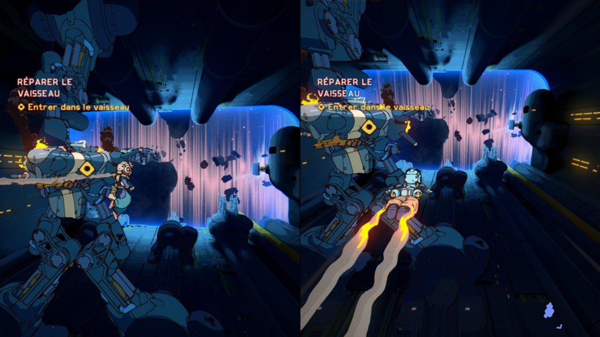
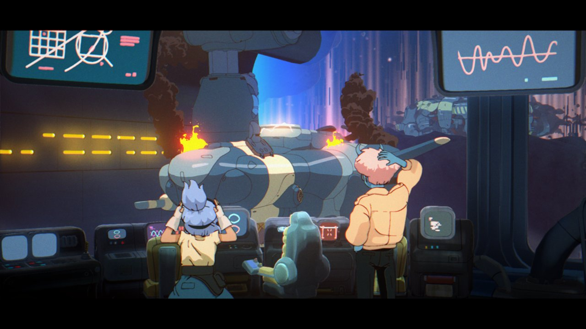
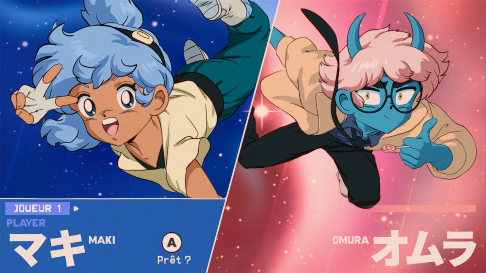
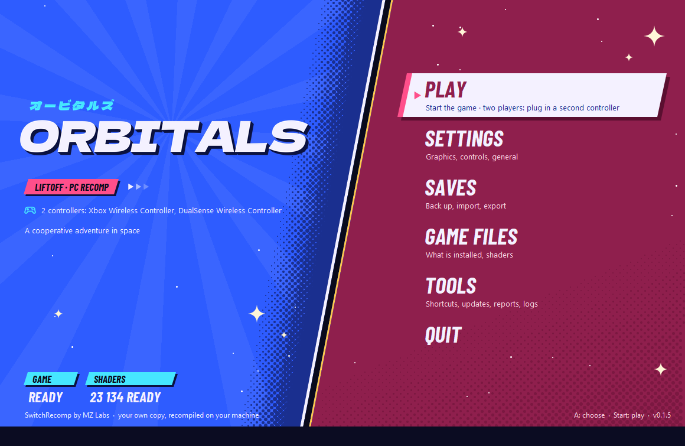
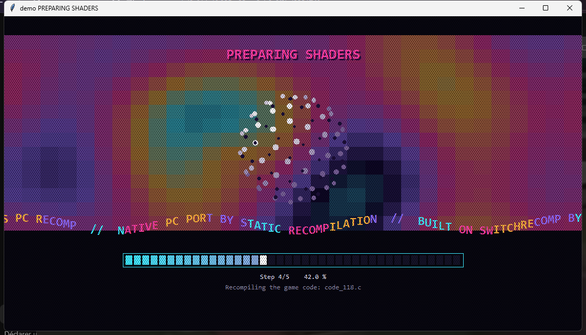

# Liftoff — Orbitals PC Recomp

<a href="https://recomplauncher.com"><picture><source media="(prefers-color-scheme: dark)" srcset="https://recomplauncher.com/assets/press/launcher/badge-light.svg"></picture></a>

**Liftoff is a native PC port of *Orbitals* for Windows and Linux / Steam Deck, made by static recompilation.**
Co-op space adventure, split screen, controllers, the game's own rendering — running natively on Vulkan, built on your PC from your own copy.



**v0.1.5** · [Releases](https://github.com/Dimi-Sama/OrbitalsPCRecomp/releases) · [Known issues](KNOWN_ISSUES.md) · [Building](BUILDING.md) ·
Built on **[SwitchRecomp by MZ Labs](docs/SWITCH2RECOMP.md)**

> This project is independent. It is not affiliated with, endorsed or sponsored by Nintendo or by the developers or publishers of
> *Orbitals*. It contains **no game files, no game code, no keys and no firmware**, and downloads none. You need your own legally
> obtained copy of the game; everything specific to it is generated on your PC from your copy. "Nintendo Switch 2" and "Orbitals" are
> trademarks of their respective owners, used here only to say what this software is compatible with. The screenshots below show the
> game running with this project; the game's art belongs to its owners.

## What's new in 0.1.5

- **A new launcher**: a title screen of its own, one menu for the next step (install, prepare shaders, play), and a small demoscene
  screen for each long task — the recompile and the shader preparation each have theirs.
- **Updates and outdated games**: the launcher finds a game compiled by an older version and recompiles it, keeping the saves.
- **Linux AppImage**: one file, its own Python with Tk included.
- **Prepare shaders**: all 23,134 shaders translated before the first session, so the first playthrough does not pause.
- **AMD, Intel and the Steam Deck**: 32-lane subgroups and kept shared memory order fix the space scene's giant sprites and bring back
  the rainbow curtain; the in-game cutscene renders as on the PC.
- **Linux**: no more stutter from memory checks, and cutscene movies stay in sync with their sound.
- **Effects**: fires, smoke, exhaust, thrusters and the rainbow curtain are drawn; the red / blue flashes after the opening film are gone.

Full notes: [docs/RELEASE_NOTES_v0.1.5.md](docs/RELEASE_NOTES_v0.1.5.md).

## Screenshots

| | |
|---|---|
|  |  |
| Main menu | The burning ship, right after the opening film: fire, smoke and the curtain |
|  |  |
| Local co-op in the colony | Space: thruster trails and the rainbow curtain |

<p align="center"><br>Character select, on the Steam Deck</p>

All captured on an RTX 5070 Laptop at 1080p, except the character select (Steam Deck OLED).

## The launcher

<table>
<tr>
<td width="50%"></td>
<td width="50%"></td>
</tr>
<tr>
<td>The title screen: its menu is the next step for your installation, its tags what is ready. Mouse or keyboard.</td>
<td>Settings: graphics, controls and the launcher, each change explained.</td>
</tr>
<tr>
<td></td>
<td></td>
</tr>
<tr>
<td><b>Recompiling the game</b> (20–60 minutes, once): an ARM64-to-C listing scrolls beside a vector wireframe, with the real
progress of the compile.</td>
<td><b>Preparing the shaders</b> (about 15 minutes, once): a plasma under a ball of lit dots, with the real count of shaders.</td>
</tr>
</table>

The demos are drawn by the launcher itself, in the spirit of the 90s demoscene — copper bars, sine scrollers and all.

## Getting started

You need: your own copy of the game, extracted to a folder with `exefs/` and `romfs/` (how you dump and decrypt your own console
software is up to you and your local law; this project ships no keys, firmware or game files); about 5 GB of free disk space (the
game data is linked, not copied); 16 GB of RAM; a Vulkan 1.3 GPU; an internet connection for the first installation.

### Windows

1. Extract `OrbitalsPCRecomp-0.1.5-windows-x64.zip` from the [Releases page](https://github.com/Dimi-Sama/OrbitalsPCRecomp/releases)
   into an empty folder.
2. Double-click **`Orbitals-Launcher.bat`** (it needs Python 3.12+ with Tk and offers to install it with winget if it is missing).
3. **INSTALL ORBITALS** → choose the folder with `exefs/` and `romfs/`. The build tools are downloaded from their official servers,
   each checked against a pinned SHA-256, into the folder; nothing is installed system-wide. Then your copy's code is recompiled.
4. **PREPARE SHADERS** (recommended), then **PLAY**. Plug in a second controller for co-op.

Without the launcher:

```powershell
git clone --branch v0.1.5 https://github.com/Dimi-Sama/OrbitalsPCRecomp.git OrbitalsPCRecomp
cd OrbitalsPCRecomp
powershell -ExecutionPolicy Bypass -File tools\release\setup-windows.ps1 -GameData D:\path\to\your\Orbitals -Jobs 4
powershell -ExecutionPolicy Bypass -File games\Orbitals\Play-Orbitals.ps1
```

### Linux

**AppImage** (the simplest): `chmod +x OrbitalsPCRecomp-0.1.5-x86_64.AppImage` and open it. It copies the kit to
`~/.local/share/OrbitalsPCRecomp/` on first start and opens the launcher.

**Archive**: extract `OrbitalsPCRecomp-0.1.5-linux-x64.tar.gz` and open **`Orbitals-Launcher.sh`**.

Either way, the recompile needs **gcc**, **SPIRV-Tools** and the **.NET 10 runtime** from your distribution, and a Vulkan driver. If one
is missing, the launcher names the packages for your distribution (apt, dnf, pacman, zypper) and puts the install command in your
clipboard. Details: [BUILDING.md § On Linux](BUILDING.md#on-linux).

### Steam Deck

The Deck has no compiler: the Linux files are built on a PC (Windows with Zig, or Linux with GCC) and copied to the Deck with your own
game data. Follow [BUILDING.md § Linux / Steam Deck](BUILDING.md#linux--steam-deck), then start `orbitals-deck.sh` from desktop mode
or add it to Steam as a non-Steam game. The **Performance** preset (720p 3D, all effects kept) is recommended there.

## Status

| | Windows 10/11 x64 | Linux x64 | Steam Deck (SteamOS) |
|---|---|---|---|
| Menus, opening film, cutscenes, saves | yes | yes | yes |
| Local co-op (2 players, split screen) | yes | yes | yes |
| Controllers (XInput / SDL), keyboard and mouse | yes | yes | yes (Steam Deck controls) |
| 30 FPS, the game's own pacing | yes | yes | below 30 in co-op |
| 60 FPS mode | **experimental** | **experimental** | not recommended |
| Online / LAN play | no | no | no |

### Measured performance (co-op, real frames, no frame generation)

| Machine | Mode | FPS |
|---|---|---:|
| RTX 5070 Laptop + i7-14650HX, 1080p | 30 (reference) | 30 |
| same | 60 (experimental) | ≈ 51–54 |
| Steam Deck OLED, 15 W | 30, Performance preset, colony | ≈ 21–22 |
| same | 30, High, space scene | ≈ 17–19 |

Methods and details: [PERFORMANCE_ROADMAP.md](PERFORMANCE_ROADMAP.md), [STEAM_DECK_PERFORMANCE.md](STEAM_DECK_PERFORMANCE.md).
Rendering checks per GPU: [GRAPHICS_ACCURACY.md](GRAPHICS_ACCURACY.md).

## How it works

The game's ARM64 code (ExeFS) is translated to C once and compiled with GCC into a native module (`Orbitals_code.dll` / `.so`). A C
runtime emulates the console's operating system services; the game's graphics API calls (NVN2) are replayed with **Vulkan**, and its
GPU shaders are translated to SPIR-V (a Ryujinx-derived translator on .NET), ahead of time with **Prepare shaders** or as the game first
uses them. The game's data (RomFS) is read as it is from your copy. Unreal Engine, its audio (Wwise) and its movies (Bink) run as the
game's own recompiled code.

## Settings

The launcher's **SETTINGS** set the graphics (preset, frame rate, 3D resolution, display, output size, upscaling, VSync), the controls
and the launcher. On Windows, the game's own **Settings** screen (main and pause menus) also opens **PC settings** in the game window:
window mode, 3D resolution, volume, keyboard player, mouse camera and vibration apply during play.

| Setting | Where | Values |
|---|---|---|
| Frame pacing | SETTINGS → GRAPHICS, `Orbitals.ini` `ue_fps` | `0` reference (30 FPS, default), `30` async replay, `60` experimental |
| Internal 3D resolution | presets High / Performance / Low / Custom, F1 during play on Windows | TV 1080p, handheld 900p, 720p, custom ([GRAPHICS_SETTINGS.md](GRAPHICS_SETTINGS.md)) |
| Output size, window / borderless | SETTINGS → GRAPHICS, `SWR_WINDOW_SIZE=WxH`, `--fullscreen` | the picture scaled to the window, never a change of 3D resolution |
| VSync | SETTINGS → GRAPHICS, `NXRT_VK_PRESENT=fifo|immediate` | |
| Upscale filter | `NXRT_VK_UPSCALE=standard|sharp|fsr1` | FSR 1 EASU when the window is larger than the picture |
| Keyboard player, volume | `keyboard_player=1|2`, `SWR_AUDIO_VOLUME=0..100` | |

Renderer switches for troubleshooting (all off unless stated): `NXRT_VK_DEVICE=<index or name>` picks the GPU,
`NXRT_VK_QUAD_SHUFFLE=0|1` (default on for Intel only), `NXRT_VK_SUBGROUP32=0`, `NXRT_VK_SHARED_VOLATILE=0|1` (default on except on
NVIDIA's driver), `NXRT_VK_TBUF_TYPED=0|1|2`, `NXRT_VK_SHADOW_LAZY=0`, `NXRT_VK_WB_GPU=0`, `NXRT_VK_VALIDATION=1` (Vulkan validation
layers, slow). The runtime writes everything it does to `Orbitals.log` beside the executable.

## Reporting a problem

Use the issue templates (graphics bug, crash, build problem, performance regression). Attach a report made with the launcher's
**HELP → Create a report** (or `python -B tools/release/bugreport.py --game-dir games/Orbitals`): logs with local paths masked, system and
GPU information, settings. It never includes your saves or any game file. Please check its contents before posting.

## Contributing

Pull requests are welcome. Keep changes small and measurable: a graphics fix comes with before/after captures of the visual suite
(`tools/visual_suite`), a performance change with an A/B of the same scripted path (`tools/claude_laptop/ab_stats.py`). Never commit game
data, shader caches, saves, logs or recompiled code (`tools/release/make_public_tree.py --dry-run` audits a tree).

## License

The code is GNU AGPL v3 ([LICENSE.txt](LICENSE.txt)) with the additional terms of [NOTICE.txt](NOTICE.txt): forks and derived works
keep the credit "SwitchRecomp by MZ Labs", `NOTICE.txt` and the SwitchRECOMP startup screen. Third-party components keep their own
licenses (Ryujinx's shader translator: MIT; Vulkan headers: Apache 2.0/MIT; Opus, OpenH264, SDL, FidelityFX FSR 1 and the others listed
in [README.txt](README.txt) and NOTICE.txt). The game itself, its code, its data and its art are not covered by any of this and remain
the property of their owners.
