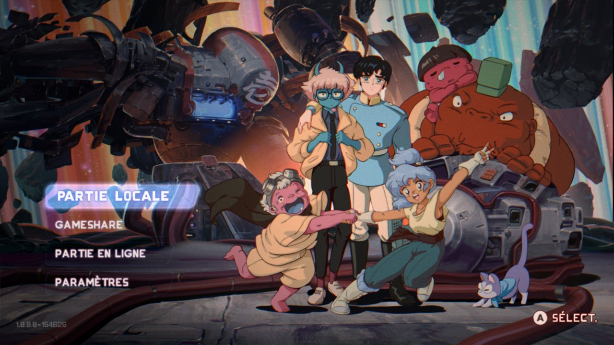
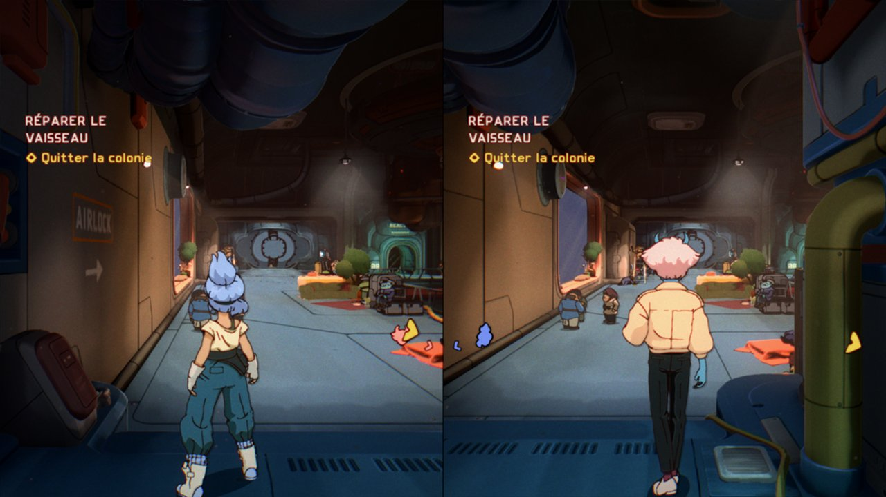
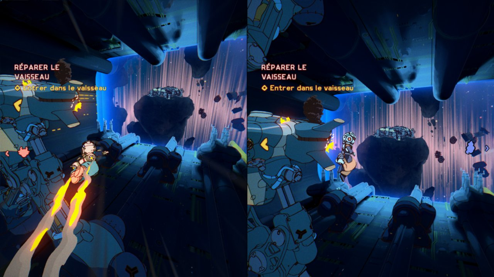
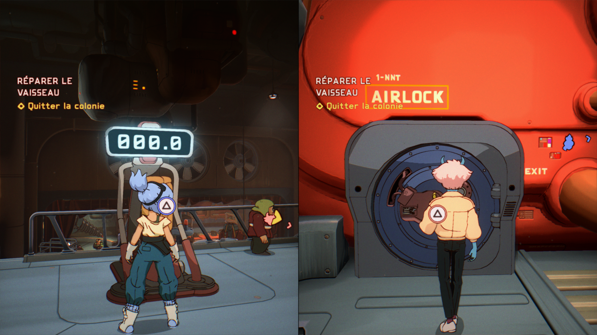
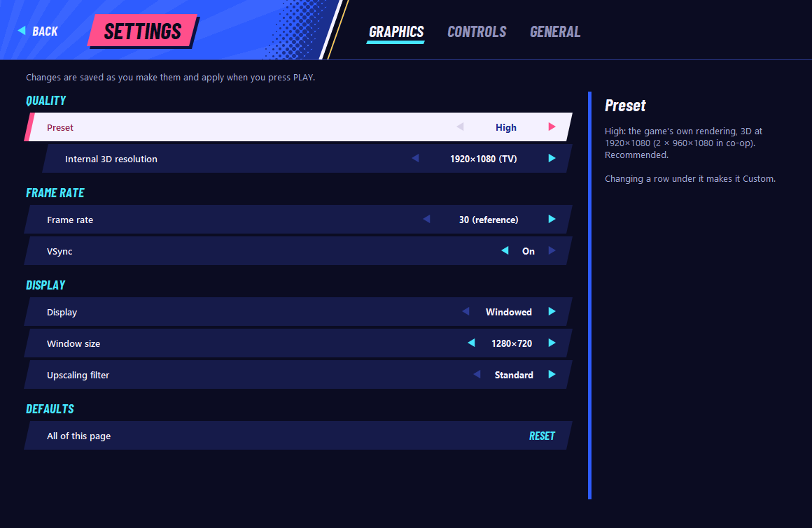
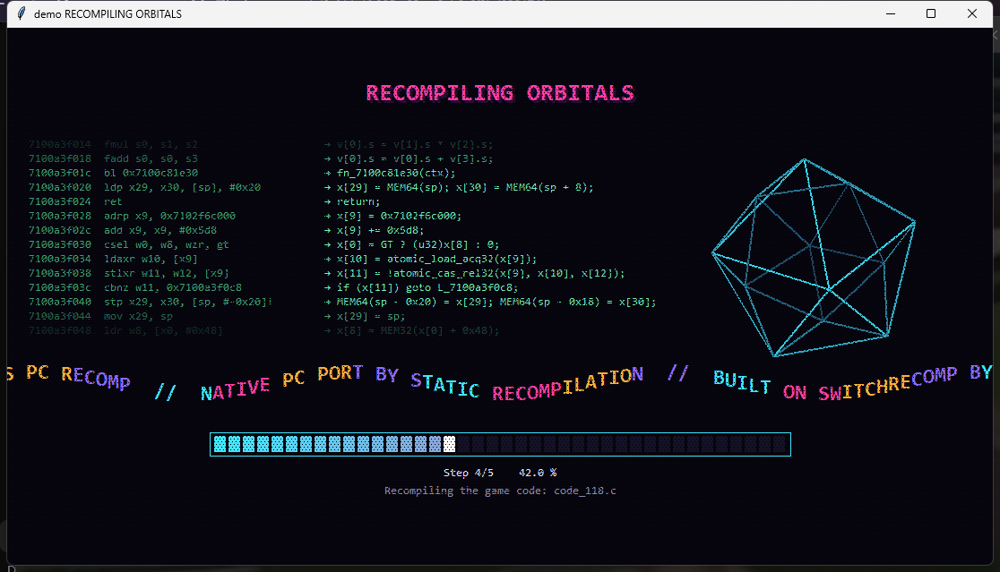

# Liftoff — Orbitals PC Recomp

**Liftoff is a native PC port of *Orbitals* for Windows and Linux / Steam Deck, made by static recompilation.**
Co-op space adventure, split screen, controllers, the game's own rendering — running natively on Vulkan, built on your PC from your own copy.

**v0.1.6** · [Getting started](#getting-started) · [Release notes](docs/RELEASE_NOTES_v0.1.6.md) · [RecompLauncher and Quiver](#recomplauncher-and-quiver) · [Public releases](https://github.com/Dimi-Sama/OrbitalsPCRecomp/releases)

Built on [SwitchRecomp by MZ Labs](docs/SWITCH2RECOMP.md).

> [!IMPORTANT]
> **Upgrading from v0.1.5 requires a one-time recompilation.** v0.1.5 predates build fingerprints, and v0.1.6 changes the generated game code.
> In the new Liftoff kit, open **Game Files**, select your existing installation folder if prompted, then choose **Check installed code**.
> Use the same game files. Liftoff keeps your saves, profiles and shader cache. Allow an estimated 20–60 minutes for a full
> build, or up to 90 minutes on Steam Deck. If the installed module has a matching build fingerprint, Liftoff can apply a quick update.


> This project is independent. It is not affiliated with, endorsed or sponsored by Nintendo or by the developers or publishers of
> *Orbitals*. It contains **no game files, no game code, no keys and no firmware**, and downloads none. You need your own legally
> obtained copy of the game; everything specific to it is generated on your PC from your copy. "Nintendo Switch 2" and "Orbitals" are
> trademarks of their respective owners, used here only to say what this software is compatible with. The screenshots below show the
> game running with this project; the game's art belongs to its owners.

## What's new in 0.1.6

- **Quick updates.** Liftoff checks the installed module before updating and shows **Quick update** or **Recompilation required**.
  Compatible updates keep `Orbitals_code.dll` or `Orbitals_code.so` in place. When a new module is needed, GCC can reuse matching
  object files from the build cache. **Restore previous version** brings back the previous runtime and module after an update.
  [Updating an installation](launcher/README.md#updating-an-installation)
- **Liftoff launcher.** Navigate with a controller, change settings that save automatically, stop supported background tasks, and
  add Liftoff to Steam. The refreshed interface scales on high-DPI displays.
- **Install from your `.nup`.** Liftoff and RecompLauncher Easy Setup accept NUP v1 archives that contain the base game, including
  archives with a bundled update or DLC. Setup extracts the base game's ExeFS and RomFS. You can also install from an extracted folder.
  [External launcher setup](#recomplauncher-and-quiver)
- **Portable and moved installations.** Create `portable.txt` next to Liftoff or its AppImage to store profiles, saves and the shader
  cache in `portable-data/`. When a move breaks the links to your extracted game, Liftoff can reconnect the original files and keep a
  compatible module. [Launcher guide](launcher/README.md#install-and-play)
- **Windows setup.** The installer verifies the downloaded Python package and opens it with .NET's ZIP support, fixing the extraction
  failure when GNU tar is first on `PATH`. If Python rejects the TLS certificate for a build-tool download with a pinned checksum,
  the installer can retry with Windows curl and verify the checksum before using the file. [Issue #1](https://github.com/Dimi-Sama/OrbitalsPCRecomp/issues/1)
- **Windows launches from deep folders.** The runtime can open long RomFS paths in the session folders created when launching through
  RecompLauncher and Quiver. Both Windows launchers reached the title screen with the fix, with Quiver launching through Liftoff.
- **TV resolution and ultrawide.** The default output is 1080p. TV mode offers up to 2160p at 16:9, experimental 2560×1080 and 3440×1440
  at 21:9, and experimental 3840×1080 and 5120×1440 at 32:9. Use **Settings → Graphics → Display → TV aspect ratio** to select a group.
  Some menus and videos retain their original framing. Internal 3D resolution has its own setting.
  [Graphics settings](GRAPHICS_SETTINGS.md) · [Issue #8](https://github.com/Dimi-Sama/OrbitalsPCRecomp/issues/8)
- **Controller layouts and gyro.** Xbox and PlayStation layouts show their own prompts. Bottom-button accept requires the generated
  configuration overlay to load from directory-backed RomFS. Nintendo controls remain the default. Windows supports opt-in gyro aiming
  per player with a motion-capable SDL3 controller. [PlayStation screenshot](#playstation-button-prompts) · [Button layouts](docs/BUTTON_LAYOUT.md) · [Gyro guide](docs/gyro.md)
- **Vulkan rendering and diagnostics.** The runtime includes fixes for NVIDIA cockpit flashes and hull outlines, expanded shader
  precision handling, and targeted buffer robustness on RADV GFX10. It keeps GPU write-back snapshots alive until completion and offers
  optional device-local snapshots, off by default. Reports include the driver, Mesa version when available, subgroup sizes and renderer
  options. [Vulkan write-backs](docs/vulkan-writeback.md) · [NVN replay comparison](TEST-ISSUE11.md)
- **RDNA1 loading and rendering.** On RADV NAVI10 and NAVI14, the runtime requests 32-lane subgroups for fragment shaders and the three
  particle-sort compute passes. The fix was validated on an RX 5700 XT in two short sessions. **Settings → General → Diagnostics** offers
  a **GPU write-back comparison** switch (`wb_gpu`) that applies on the next launch. [Issue #7](https://github.com/Dimi-Sama/OrbitalsPCRecomp/issues/7)

## Issue status

These statuses describe v0.1.6. Follow the linked issues for reports from other configurations.

| Issue | Status in v0.1.6 | Details |
|---|---|---|
| [#1 · Windows Python setup](https://github.com/Dimi-Sama/OrbitalsPCRecomp/issues/1) | Fixed | The installer verifies and extracts the Python package using .NET ZIP support. |
| [#8 · Ultrawide and update feedback](https://github.com/Dimi-Sama/OrbitalsPCRecomp/issues/8) | Implemented | Experimental native 21:9 and 32:9 output are available. Feedback in this thread also led to quick updates. |
| [#13 · Moved game folders](https://github.com/Dimi-Sama/OrbitalsPCRecomp/issues/13), [#14 · Portable data](https://github.com/Dimi-Sama/OrbitalsPCRecomp/issues/14) | Implemented | Liftoff reconnects missing game-data links and supports portable profiles, saves and shader cache. GitHub tracks the follow-up in #14. |
| [#2 · NVIDIA flashes and hull outlines](https://github.com/Dimi-Sama/OrbitalsPCRecomp/issues/2) | Fix included, follow-up open | The original patch was tested on RTX 4090 and confirmed on RTX 4060. A preview tester still reports glitches on RTX 4080. [RTX 4080 report](https://github.com/Dimi-Sama/OrbitalsPCRecomp/issues/2#issuecomment-7211432335) |
| [#7 · RX 5700 XT loading crash](https://github.com/Dimi-Sama/OrbitalsPCRecomp/issues/7) | Fixed | xTuniKx verified the loading, rendering and cinematic skip fixes on an RX 5700 XT in two short sessions, with GPU write-back comparison on and off. |
| [#15 · RX 9070 XT contours and prompts](https://github.com/Dimi-Sama/OrbitalsPCRecomp/issues/15) | Awaiting confirmation | The shader precision change applies to vertex and fragment shaders. Contours and missing door prompts need separate checks on the reported GPU. |
| [#11 · Low frame rate](https://github.com/Dimi-Sama/OrbitalsPCRecomp/issues/11) | Investigating | The diagnostic runner compares replay and fence-wait modes. A performance improvement on the reported setup still needs confirmation. |
| [#4 · Startup logo colours](https://github.com/Dimi-Sama/OrbitalsPCRecomp/issues/4) | Open | The startup logos can still show incorrect colours. |
| [#9 · Native PS5 port](https://github.com/Dimi-Sama/OrbitalsPCRecomp/issues/9) | Closed | The project targets Windows and Linux, including Steam Deck. |

The campaign opening reached playable co-op on an RTX 5070 Laptop and on Steam Deck. The successful Deck session used VSync off.
The Debian launcher and native runtime checks used synthetic game data. [Known issues from earlier builds](KNOWN_ISSUES.md)

## Community credits

- **Vinicius Stanula (`ViniciusStanula`)** contributed the launcher refresh, controller navigation, high-DPI support and settings improvements.
  [PR #3](https://github.com/Dimi-Sama/OrbitalsPCRecomp/pull/3)
- **Leonardo Zerpa (`leonardozerpa2497`)** contributed the TV resolution hook and launcher setting that underpin native ultrawide, the
  gyro implementation, Vulkan write-back lifetime fixes and device-local snapshots, and the controller layout and menu button support.
  [PR #5](https://github.com/Dimi-Sama/OrbitalsPCRecomp/pull/5) · [PR #6](https://github.com/Dimi-Sama/OrbitalsPCRecomp/pull/6) ·
  [PR #12](https://github.com/Dimi-Sama/OrbitalsPCRecomp/pull/12) · [PR #16](https://github.com/Dimi-Sama/OrbitalsPCRecomp/pull/16) ·
  [PR #17](https://github.com/Dimi-Sama/OrbitalsPCRecomp/pull/17)
- **Xarishark** contributed the RecompLauncher setup and play integration. [PR #10](https://github.com/Dimi-Sama/OrbitalsPCRecomp/pull/10)
- **KingsmanZer0** diagnosed the NVIDIA cockpit flashes and hull outlines, shared the shader patch and tested it on RTX 4090. The shader
  precision work for AMD builds on that patch. KingsmanZer0 also reported the startup logo colours. **`youdeend3`** reported the ship
  rendering glitches, **`rodrigeoBR`** confirmed the original patch on RTX 4060, and **`gabriel26101995-art`** reported the remaining glitch on RTX 4080.
  **`slimx`** pointed to **`pete842`**'s shared-memory work in Lichii.
  [Patch and diagnosis](https://github.com/Dimi-Sama/OrbitalsPCRecomp/issues/2#issuecomment-7183991749) ·
  [RTX 4060 confirmation](https://github.com/Dimi-Sama/OrbitalsPCRecomp/issues/2#issuecomment-7213530322) · [Lichii PR #2082](https://github.com/zortos293/Lichii/pull/2082) ·
  [Issue #4](https://github.com/Dimi-Sama/OrbitalsPCRecomp/issues/4)
- **`justifun`** reported the Python setup failure. **`asdad3mgg-boop`** requested ultrawide and explained how recurring rebuilds made
  updates impractical. **Trasterin** reported the broken links after moving an installation and proposed portable data.
  [Issue #1](https://github.com/Dimi-Sama/OrbitalsPCRecomp/issues/1) · [Update feedback](https://github.com/Dimi-Sama/OrbitalsPCRecomp/issues/8#issuecomment-7210859167) ·
  [Issue #13](https://github.com/Dimi-Sama/OrbitalsPCRecomp/issues/13) · [Issue #14](https://github.com/Dimi-Sama/OrbitalsPCRecomp/issues/14)
- **`lustrousdragon`** offered to test 32:9 at 5120×1440 and suggested 3840×1080 as a lower-resolution option.
  [Issue #8 · Testing offer](https://github.com/Dimi-Sama/OrbitalsPCRecomp/issues/8#issuecomment-7214740602) ·
  [Issue #8 · 3840×1080 suggestion](https://github.com/Dimi-Sama/OrbitalsPCRecomp/issues/8#issuecomment-7215991143)
- **`xTuniKx`** tested every RDNA1 build and validated the fix on an RX 5700 XT. They shared the crash and validation logs.
  **Grazorus** provided diagnostics for the low-frame-rate report, and **`mayacaalahussle-cmd`** reported the RX 9070 XT contours and missing prompts.
  [Issue #7](https://github.com/Dimi-Sama/OrbitalsPCRecomp/issues/7) · [Issue #11](https://github.com/Dimi-Sama/OrbitalsPCRecomp/issues/11) ·
  [Issue #15](https://github.com/Dimi-Sama/OrbitalsPCRecomp/issues/15)

[Release notes for v0.1.6](docs/RELEASE_NOTES_v0.1.6.md) · [Previous release notes](docs/RELEASE_NOTES_v0.1.5.md).

## Screenshots

| | |
|---|---|
|  |  |
| Main menu | The burning ship, right after the opening film: fire, smoke and the curtain |
|  |  |
| Local co-op in the colony | Space: thruster trails and the rainbow curtain |

<p align="center"><br>Character select, on the Steam Deck</p>

All captured on an RTX 5070 Laptop at 1080p, except the character select (Steam Deck OLED).

### PlayStation button prompts



## The launcher

<table>
<tr>
<td width="50%"></td>
<td width="50%"></td>
</tr>
<tr>
<td>The title screen shows the next step for your installation. Navigate with a mouse, keyboard or controller.</td>
<td>Settings: graphics, controls and the launcher, each change explained.</td>
</tr>
<tr>
<td></td>
<td></td>
</tr>
<tr>
<td><b>Recompiling the game</b> (20–60 minutes for a full build): an ARM64-to-C listing scrolls beside a vector wireframe, with the real
progress of the compile.</td>
<td><b>Preparing the shaders</b> (about 15 minutes, once): a plasma under a ball of lit dots, with the real count of shaders.</td>
</tr>
</table>

The demos are drawn by the launcher itself, in the spirit of the 90s demoscene — copper bars, sine scrollers and all.

## Getting started

You need your own copy as a NUP v1 archive containing the base game or a folder with `exefs/` and `romfs/`, 16 GB of RAM, a Vulkan 1.3 GPU,
and an internet connection for the initial tool downloads. Allow about 5 GB for the build, plus room for the extracted game when
installing from a `.nup`. Liftoff lets you choose the installation folder. [Launcher guide](launcher/README.md#install-and-play)

To update an installation you already have, open the new kit and follow [Updating an installation](launcher/README.md#updating-an-installation).

### Windows

1. Extract the Windows x64 ZIP for your version into an empty folder. [Public releases](https://github.com/Dimi-Sama/OrbitalsPCRecomp/releases)
2. Double-click **`Orbitals-Launcher.bat`** (it needs Python 3.12+ with Tk and offers to install it with winget if it is missing).
3. Open **SET UP ORBITALS**, choose your `.nup` containing the base game or the folder with `exefs/` and `romfs/`, then select **INSTALL**. Liftoff
   downloads the build tools from their official servers, verifies their pinned SHA-256 checksums and recompiles your copy locally.
4. **Prepare now** on the card about the shaders (recommended), then **PLAY**. Plug in a second controller for co-op.

To install from an extracted game folder without the launcher, run these commands from the kit directory.

```powershell
powershell -ExecutionPolicy Bypass -File tools\release\setup-windows.ps1 -GameData D:\path\to\your\Orbitals -Jobs 4
powershell -ExecutionPolicy Bypass -File games\Orbitals\Play-Orbitals.ps1
```

### Linux

Extract the Linux x64 archive for your version and open **`Orbitals-Launcher.sh`**. If your release includes an AppImage, make that
file executable and open it. The AppImage copies the kit to `~/.local/share/OrbitalsPCRecomp/` on its first start.

Either way, the recompile needs **gcc**, **SPIRV-Tools** and the **.NET 10 runtime** from your distribution, and a Vulkan driver. If one
is missing, the launcher names the packages for your distribution (apt, dnf, pacman, zypper) and puts the install command in your
clipboard. Details: [BUILDING.md § On Linux](BUILDING.md#on-linux).

### Steam Deck

Open the Linux kit in Desktop Mode. A quick runtime update works with the existing module. When a rebuild is required, use a Deck
with the Linux build tools already set up or compile on a PC and copy the result. Follow [the Steam Deck build guide](BUILDING.md#linux--steam-deck),
then start `orbitals-deck.sh` from Desktop Mode or add it to Steam as a non-Steam game. The **Performance** preset uses 720p internal 3D.

## RecompLauncher and Quiver

**RecompLauncher.** The kit includes a `recomplauncher.json` manifest with **Easy Setup** and **Play**. When Easy Setup asks for
your game files, select the `.nup` containing the base game or the extracted folder containing `exefs/` and `romfs/`. It checks whether the installed module can be
reused and recompiles your copy when needed. Shader preparation is optional. [RecompLauncher setup](launcher/README.md#external-launchers)

**Quiver.** With a version that reads the kit's play manifest, **Play** opens Liftoff when setup is needed. After setup, **Play**
starts the selected installation. You can also add Liftoff as a local program using `Orbitals-Launcher.bat` on Windows or
`Orbitals-Launcher.sh` or the AppImage on Linux and Steam Deck. Then choose **Play** inside Liftoff.
[Quiver setup](launcher/README.md#external-launchers)

## Status

| | Windows 10/11 x64 | Linux x64 | Steam Deck (SteamOS) |
|---|---|---|---|
| Menus, opening film, cutscenes, saves | yes | yes | yes |
| Local co-op (2 players, split screen) | yes | yes | yes |
| Controllers (XInput / SDL), keyboard and mouse | yes | yes | yes (Steam Deck controls) |
| 30 FPS, the game's own pacing | yes | yes | below 30 in co-op |
| 60 FPS mode | **experimental** | **experimental** | not recommended |
| Online / LAN play | no | no | no |

Performance still varies by scene, hardware and settings. In one v0.1.6 preview test on an RTX 3060 with a Ryzen 7 5800X,
the game ran at roughly 25–30 FPS. We are continuing to work on frame rate and frame pacing, especially in demanding co-op scenes.

[Rendering checks by GPU](GRAPHICS_ACCURACY.md)

## How it works

The game's ARM64 code (ExeFS) is translated to C and compiled with GCC into a native module (`Orbitals_code.dll` / `.so`). A C
runtime emulates the console's operating system services; the game's graphics API calls (NVN2) are replayed with **Vulkan**, and its
GPU shaders are translated to SPIR-V (a Ryujinx-derived translator on .NET), ahead of time with **Prepare shaders** or as the game first
uses them. The game's data (RomFS) is read as it is from your copy. Unreal Engine, its audio (Wwise) and its movies (Bink) run as the
game's own recompiled code.

## Settings

The launcher's **SETTINGS** set the graphics (preset, frame rate, 3D resolution, display, output size, upscaling, VSync), the controls
and the launcher. On Windows, the game's own **Settings** screen (main and pause menus) also opens **PC settings** in the game window:
window mode, 3D resolution, volume, keyboard player, mouse camera and vibration apply during play.

| Setting | Where | Values |
|---|---|---|
| Frame pacing | SETTINGS → GRAPHICS, `Orbitals.ini` `ue_fps` | `0` reference (30 FPS, default), `30` async replay, `60` experimental |
| Internal 3D resolution | presets High / Performance / Low / Custom, F1 during play on Windows | TV 1080p, handheld 900p, 720p, custom ([GRAPHICS_SETTINGS.md](GRAPHICS_SETTINGS.md)) |
| TV aspect ratio and resolution | SETTINGS → GRAPHICS → Display, `Orbitals.ini` `display_resolution` | 1080p by default, up to 2160p in 16:9, experimental 21:9 and 32:9 |
| Output size, window / borderless | SETTINGS → GRAPHICS, `SWR_WINDOW_SIZE=WxH`, `--fullscreen` | the picture scaled to the window, never a change of 3D resolution |
| Ultrawide stretch | SETTINGS → GRAPHICS → Display, `NXRT_VK_STRETCH_WIDE=1` | experimental horizontal stretch to fill a wider window, off by default |
| VSync | SETTINGS → GRAPHICS, `NXRT_VK_PRESENT=fifo|immediate` | |
| Upscale filter | `NXRT_VK_UPSCALE=standard|sharp|fsr1` | FSR 1 EASU when the window is larger than the picture |
| Keyboard player, volume | `keyboard_player=1|2`, `SWR_AUDIO_VOLUME=0..100` | |
| GPU write-back comparison | SETTINGS → GENERAL → Diagnostics | On compares write-backs on the GPU. Off compares them on the CPU. |

For native ultrawide, select the matching **Window size** or use **Borderless** on an ultrawide display. Some menus and videos retain
their 16:9 framing. [Graphics settings](GRAPHICS_SETTINGS.md)

Renderer switches for troubleshooting (all off unless stated): `NXRT_VK_DEVICE=<index or name>` picks the GPU,
`NXRT_VK_QUAD_SHUFFLE=0|1` (default on for Intel only), `NXRT_VK_SUBGROUP32=0`, `NXRT_VK_SHARED_VOLATILE=0|1` (default on except on
NVIDIA's driver), `NXRT_VK_TBUF_TYPED=0|1|2`, `NXRT_VK_SHADOW_LAZY=0`, `NXRT_VK_WB_GPU=0`, `NXRT_VK_VALIDATION=1` (Vulkan validation
layers, slow). The runtime writes everything it does to `Orbitals.log` beside the executable.

## Reporting a problem

Use the issue templates (graphics bug, crash, build problem, performance regression). Attach a report made with the launcher's
**TOOLS → Report a problem**. The ZIP can include logs with local paths masked, system and GPU information, and settings. Saves are
included only when you select them explicitly. Preview the contents before posting. The command-line report tool is
`python -B tools/release/bugreport.py --game-dir games/Orbitals`.

## Contributing

Pull requests are welcome. Keep changes small and measurable: a graphics fix comes with before/after captures of the visual suite
(`tools/visual_suite`), a performance change with an A/B of the same scripted path (`tools/claude_laptop/ab_stats.py`). Never commit game
data, shader caches, saves, logs or recompiled code (`tools/release/make_public_tree.py --dry-run` audits a tree).

## License

The code is GNU AGPL v3 ([LICENSE.txt](LICENSE.txt)) with the additional terms of [NOTICE.txt](NOTICE.txt): forks and derived works
keep the credit "SwitchRecomp by MZ Labs", `NOTICE.txt` and the SwitchRECOMP startup screen. Third-party components keep their own
licenses (Ryujinx's shader translator: MIT; Vulkan headers: Apache 2.0/MIT; Opus, OpenH264, SDL, FidelityFX FSR 1 and the others listed
in [README.txt](README.txt) and NOTICE.txt). The game itself, its code, its data and its art are not covered by any of this and remain
the property of their owners.

## Star history

<a href="https://www.star-history.com/?repos=Dimi-Sama%2FOrbitalsPCRecomp&amp;type=date">
  <picture>
    <source media="(prefers-color-scheme: dark)" srcset="https://api.star-history.com/svg?repos=Dimi-Sama/OrbitalsPCRecomp&amp;type=Date&amp;theme=dark">
    
  </picture>
</a>
